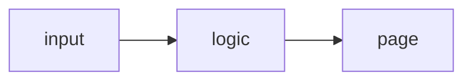

# How __TITLE__ is built

A static site: HTML, CSS and plain JavaScript, no framework and no bundler. Everything runs in the browser.

## Runtime

| Piece | What it uses |
|---|---|
| | |

Dev only: Vitest (unit tests), Playwright + axe-core (browser and accessibility tests).

## Files

```
index.html        the page
main.js           …
tests/, e2e/      unit tests (Vitest) and browser tests (Playwright, desktop + phone, axe)
```

## How it fits together



## Core techniques

## Testing and deploy

- `npm test`: Vitest on the pure modules.
- `npm run test:e2e`: Playwright at desktop and phone size against the real page, with axe accessibility checks.
- Pushing to `main` runs both in GitHub Actions (the shared workflow in
  [csciuto/app-template](https://github.com/csciuto/app-template)); only if they pass is the site stamped with
  a version and published to GitHub Pages.

## Known limits
